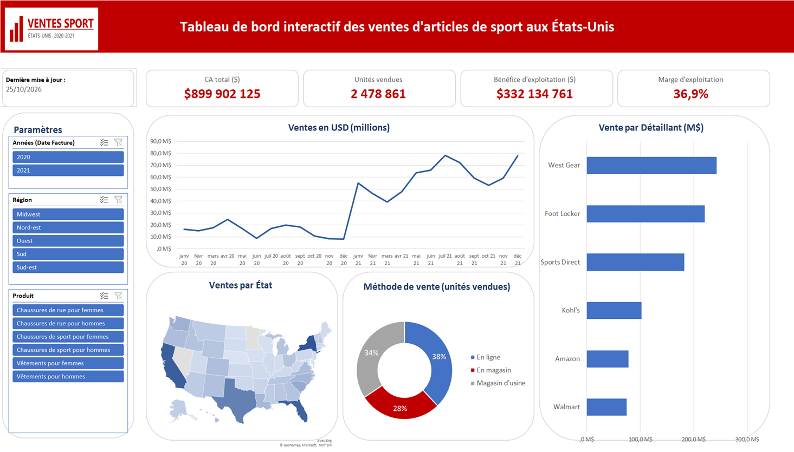

### Où et comment se vendent les articles de sport aux États-Unis ?

Ce projet est un tableau de bord Excel interactif. Les données sont le jeu public des ventes Adidas aux États-Unis (Kaggle), traduit en français pour l'exercice.

#### Le problème

Une enseigne qui distribue chaussures et vêtements de sport aux États-Unis veut savoir où concentrer ses efforts commerciaux. Le tableau de bord répond à six questions. Comment les ventes évoluent-elles de mois en mois ? Quels détaillants pèsent le plus ? Quels États et quelles régions concentrent les ventes ? Quel canal de vente rapporte le plus ? Quels produits portent l'activité ? Et quels jours de la semaine sont les plus rentables ?

#### Les données

Le fichier contient 9 648 ventes, du 1er janvier 2020 au 31 décembre 2021. Chaque ligne donne le détaillant, la date, la région, l'État, la ville, le produit, le prix unitaire, les unités vendues, le chiffre d'affaires, le bénéfice et la marge d'exploitation, ainsi que le canal de vente. Elles couvrent six détaillants, les 50 États, six familles de produits et trois canaux : en ligne, en magasin et magasin d'usine.

Les données sont complètes, sans valeur manquante ni ligne en double, et la marge est cohérente avec le bénéfice sur toutes les lignes. En les contrôlant, j'ai pourtant relevé trois points qui changent la lecture.

Pour 40 % des lignes, le chiffre d'affaires vaut exactement dix fois le prix multiplié par les unités. C'est le cas de toutes les ventes en magasin, contre 38 % des ventes en magasin d'usine et 20 % des ventes en ligne. Ces lignes portent à elles seules 96 % du chiffre d'affaires affiché. L'une des deux colonnes est donc erronée, sans qu'on puisse savoir laquelle : les montants absolus sont à prendre avec prudence, alors que les parts relatives des détaillants, des régions et des produits restent les mêmes quelle que soit la façon de compter.

Ensuite, 2020 ne couvre que 9 États et 5 détaillants, contre 46 États et 6 détaillants en 2021. Une partie de la hausse entre les deux années vient donc d'un périmètre plus large, pas de ventes plus fortes.

Enfin, la traduction a touché des noms propres : le détaillant West Gear était devenu « Ouest Gear », certains États étaient à moitié traduits, comme « Sud Carolina », la région Midwest était devenue « Milieu ouest » et le canal Outlet « Sortie ». Ces noms ont été corrigés dans le classeur.

#### La méthode

La préparation se fait dans Excel. Des colonnes calculées extraient l'année, le mois et le jour de la semaine, et rétablissent le nom anglais des États pour que la carte les reconnaisse. Les données forment une plage nommée qui alimente des tableaux croisés dynamiques.

Trois segments (année, région et produit) pilotent ces tableaux croisés. Leur sélection est reportée dans une colonne de filtre, à l'aide des fonctions NB.SI, et les indicateurs et graphiques sont recalculés avec SOMME.SI. Les quatre indicateurs, la courbe mensuelle, la carte des États, l'anneau des canaux et les barres des détaillants réagissent ainsi tous aux mêmes filtres. L'anneau des canaux compte les unités vendues plutôt que le chiffre d'affaires, pour ne pas dépendre de l'anomalie décrite plus haut.

Les chiffres ci-dessous ont été recalculés à part en Python, directement sur les données, pour contrôler le tableau de bord et mesurer l'effet des anomalies. J'utilise Claude, un assistant IA, pour m'aider dans ces vérifications et pour améliorer le design de mes tableaux de bord.

#### Les résultats

Sur deux ans, le tableau de bord affiche 900 millions de dollars de ventes, 2,5 millions d'unités et une marge d'exploitation de 37 %, sous la réserve sur les montants décrite plus haut.

Les ventes oscillent entre 8 et 25 millions de dollars par mois en 2020, puis entre 39 et 78 millions en 2021, avec des pics en juillet et en décembre. Le tableau de bord affiche une multiplication par quatre, mais à périmètre égal, sur les cinq couples État-détaillant présents les deux années, la hausse est d'environ 70 %. Cette base étroite invite à la prudence, mais l'essentiel du saut de janvier 2021 vient de l'élargissement du périmètre.

Deux détaillants font la moitié des ventes : West Gear (27 %) et Foot Locker (24 %). Sports Direct, troisième avec 20 %, dégage la meilleure marge, 41 %. Ce classement reste le même quelle que soit la façon de compter.

L'Ouest est la première région, avec 30 % des ventes. New York, la Californie, la Floride et le Texas en réalisent à eux quatre plus d'un quart. Le Sud, plus modeste en volume, a la meilleure marge, 42 %.

Pour les canaux, le chiffre d'affaires placerait le magasin en tête avec 40 %, mais ce résultat repose sur l'anomalie décrite plus haut, puisque toutes les ventes en magasin sont multipliées par dix. En unités vendues, la mesure retenue dans le tableau de bord, c'est la vente en ligne qui arrive en tête avec 38 %, devant le magasin d'usine (34 %) et le magasin (28 %). La vente en ligne a aussi la meilleure marge, 39 %.

Les chaussures de rue pour hommes sont le produit phare : 23 % des ventes et la meilleure marge, 40 %. Les vêtements pour femmes suivent, avec 20 %.

Enfin, le jeudi et le vendredi sont les jours les plus forts (16 % des ventes chacun) et le lundi le plus faible (12,5 %). Ces écarts restent modestes.

#### Recommandations et impact

La première décision est de fiabiliser la donnée. Les lignes multipliées par dix portent 96 % du chiffre d'affaires affiché : tant qu'elles ne sont pas corrigées à la source, les canaux doivent se comparer en unités vendues, comme le fait désormais le tableau de bord.

Il faut ensuite miser sur la vente en ligne. C'est le premier canal en volume et le plus rentable, alors qu'un tableau de bord fondé sur le chiffre d'affaires laisserait croire l'inverse.

West Gear et Foot Locker assurent à eux deux la moitié des ventes : ces partenariats sont à sécuriser en priorité. Les conditions obtenues avec Sports Direct, le plus rentable, peuvent servir de référence dans les négociations.

Côté géographie, l'effort commercial doit cibler les quatre grands États et l'Ouest, qui concentrent le volume, tout en développant le Sud, la région la plus rentable.

Enfin, les chaussures de rue pour hommes, à la fois produit le plus vendu et le plus rentable, doivent rester prioritaires dans les stocks et les promotions.

#### Ouvrir le projet

Téléchargez Dashboard-Ventes-Sport-USA.xlsx et ouvrez-le avec Excel pour Microsoft 365 ou Excel 2019, qui gèrent les segments et la carte des États. La feuille Dashboard contient le tableau de bord, donneesVentes les données et Calculs les tableaux intermédiaires.

Auteur : Philippe Ntale
